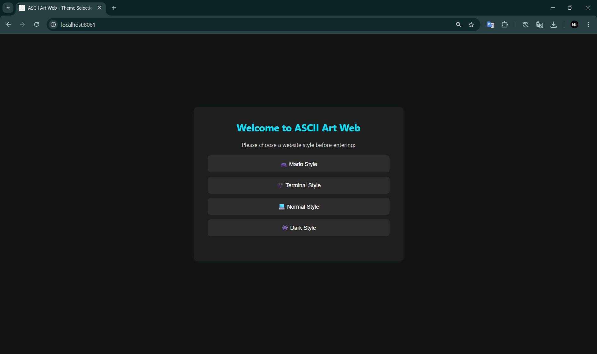
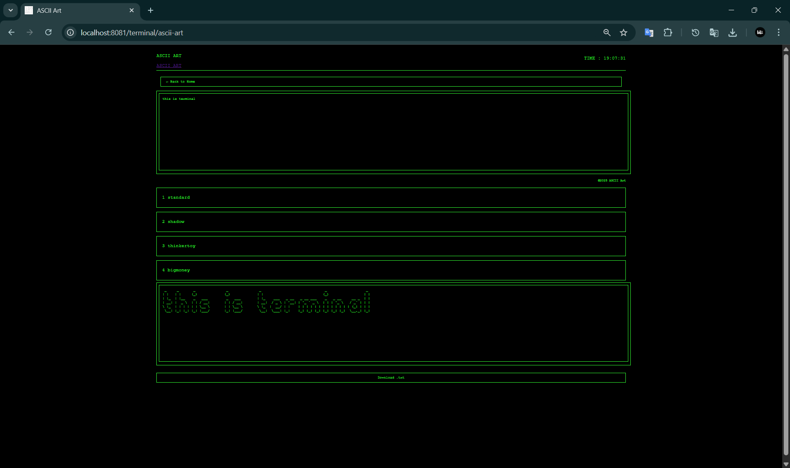
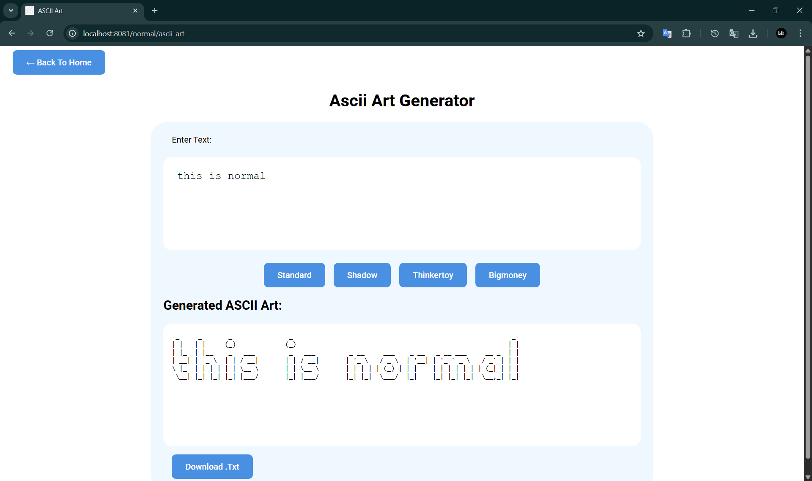
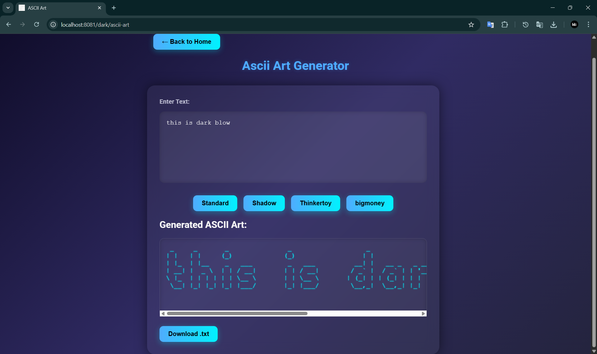
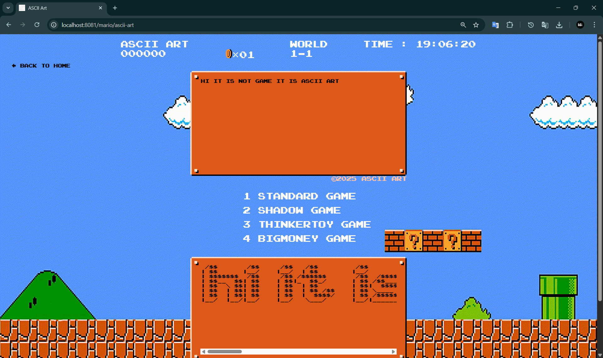

# 🎨 ASCII Art Web 

## Description

**ASCII Art Web Stylizer** is a full-stack web application that lets users convert any custom text into beautifully rendered ASCII art using different styles (banners). The app provides a playful experience through multiple visual themes such as **Mario**, **Terminal**, **Dark**, and **Normal**, each with its own aesthetic.

Whether you like a retro 8-bit game feel or a sleek terminal vibe, this app lets you choose your theme and generate stylish ASCII output in real-time.

---

## Features

- 🎮 Multiple Themes: Choose from Mario, Terminal, Dark, and Normal layouts.
- 🎨 Font Styles: Supports `standard`, `shadow`, `thinkertoy`, and `bigmoney` banners.
- 💾 Cookie Counter: Counts how many ASCII banners you've generated using cookies.
- 💻 Backend in Go: Built with Go (Golang) for optimal speed and concurrency.
- ❌ Custom Error Pages: Includes dynamic 404 and 500 error handlers with styled UI and even background video/audio in Mario mode.

- 📥 Export ASCII: Download generated ASCII art as a .txt file (or optional .zip) with correct headers.

---

## Usage

1. Open terminal and run the application:
   ```bash
   go run .


2.Visit the displayed `localhost:8081` link in your browser.

3.Choose your favorite theme from the homepage.

4.Enter your text, pick a banner style, and press generate.

5.Watch your text come to life in ASCII art!

6.Click the "Download .txt" button (appears after generation) to save the exact ASCII output locally.

## How It Works

- Backend `(Go)` processes input text using the selected banner font.

- Each banner corresponds to a `.txt` font file located in the `fonts/` directory.

- `ASCIIArt.go` handles the rendering logic, line-by-line.

- Themes are handled by dedicated HTML templates under `templates/themes/.`

- If a banner or route is invalid, it gracefully redirects to a stylized error page.

## File Structure

```bash
ascii-art-web-stylize/
│.
├── Dockerfile
├── README.md
├── ascii-art.exe
├── backend
│   ├── AsciiArt.go
│   ├── ErrorHandler.go
│   ├── Handler.go
│   ├── PrintLine.go
│   └── PrintLineForbigmoney.go
├── errorMessages
│   ├── 400.txt
│   ├── 404.txt
│   └── 500.txt
├── fonts
│   ├── bigmoney.txt
│   ├── shadow.txt
│   ├── standard.txt
│   └── thinkertoy.txt
├── frontend
│   ├── Assets
│   │   ├── Audio
│   │   │   └── coinCollect.mp3
│   │   ├── background.gif
│   │   ├── errorBg1.mp4
│   │   ├── favicon.png
│   │   ├── goomba.png
│   │   ├── inputBox.png
│   │   ├── mario-coin.gif
│   │   ├── super-mario-bros-nes.otf
│   │   └── unused
│   │       ├── backgroundold.gif
│   │       ├── errorBg1.mp4
│   │       ├── home.png
│   │       ├── newTitle.png
│   │       ├── shadow.png
│   │       ├── standard.png
│   │       ├── thinkertoy.png
│   │       └── title.png
│   └── css
│       ├── dark.css
│       ├── home-style.css
│       ├── mario.css
│       ├── normal.css
│       └── terminal.css
├── go.mod
├── main.go
└── templates
    ├── dark.html
    ├── errdefault.html
    ├── errorPage.html
    ├── homepage.html
    ├── index.html
    ├── normal.html
    └── terminal.html
```

## Export Feature

After generating ASCII art in any theme (Mario, Terminal, Normal, Dark) a "Download .txt" button appears below the rendered output.

Download flow:
1. Browser posts to /export with fields: inputText, banner, style.
2. Server regenerates the ASCII using the same backend logic (no stale cache risk) and streams it back as a file.
3. Response headers (inspect via DevTools > Network) include:
   - Content-Type: text/plain; charset=utf-8
   - Content-Length: <exact bytes>
   - Content-Disposition: attachment; filename="ascii-art-YYYYMMDD-HHMMSS.txt"

Optional: Add ?format=zip or form field format=zip to receive a .zip containing the txt.

Security & Permissions:
- Input size limited to 20KB via http.MaxBytesReader.
- Only approved banner/font names are accepted.
- A temporary server-side file is created with mode 0600 (exclusive to the process) then removed immediately after streaming (see ExportHandler in main.go).
- Client-side file permissions are determined by the operating system and browser; the server cannot enforce them.

## Audit Checklist Mapping

| Requirement | Implementation |
|-------------|----------------|
| POST /export handler | main.go: ExportHandler |
| Reuse ASCII generation | backend/AsciiArt.go (ASCIIArt) reused directly |
| Input normalization CRLF→LF | ExportHandler replaces "\r" |
| Size limit 20KB | http.MaxBytesReader in ExportHandler |
| Headers (type/length/disposition) | ExportHandler sets all before write |
| Temp file 0600 then removed | ExportHandler (os.CreateTemp + os.Chmod + defer os.Remove) |
| Download button in templates | templates/index.html, normal.html, terminal.html, dark.html |
| Error handling/logging | ExportHandler uses backend.ErrorHandler + log.Printf |
| No external deps | Only Go stdlib imports in changes |
| Optional zip support | ExportHandler (archive/zip path) |
| README updated | This section |


## Authors 

- [Bader Alafoo](https://learn.reboot01.com/git/balafoo)
- [Batool Sayed](https://learn.reboot01.com/git/basayed)
- [Hussain Ali](https://learn.reboot01.com/git/hussainali7)


# ascii-art-web

## Preview

### Home Page


### Terminal Theme


### Normal Theme


### Dark Theme


### Mario Theme


